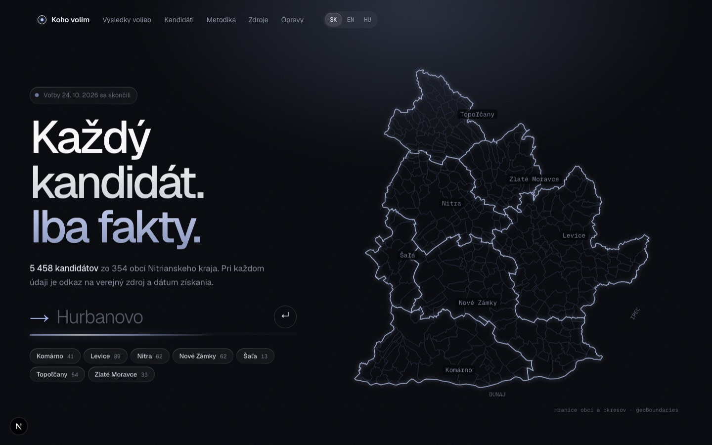
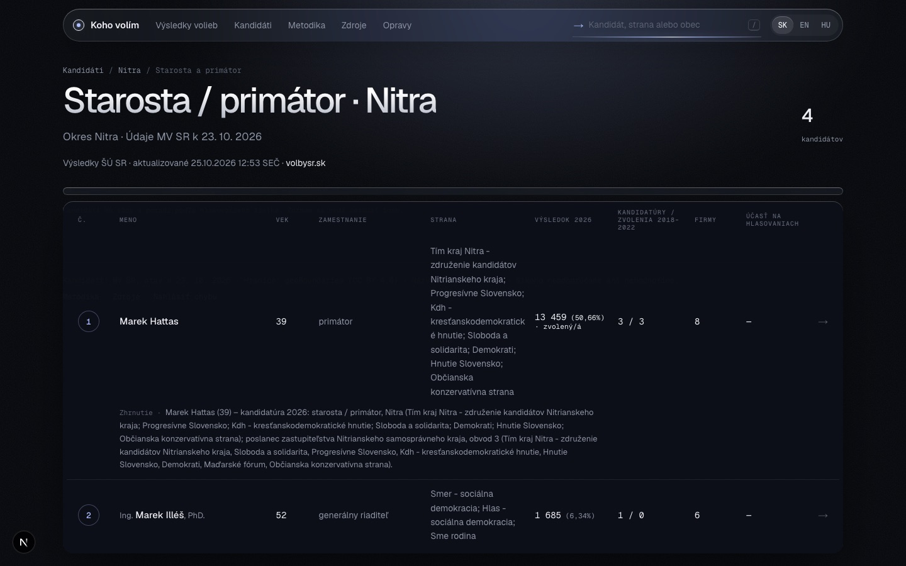
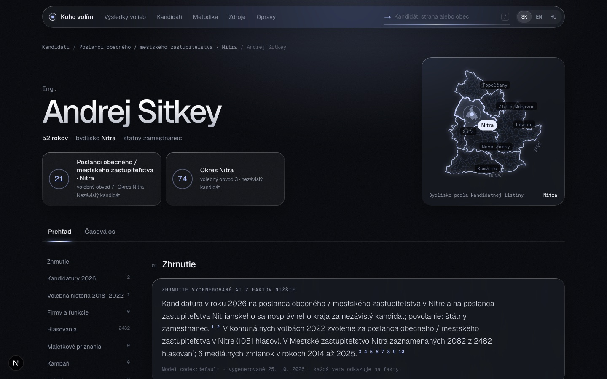
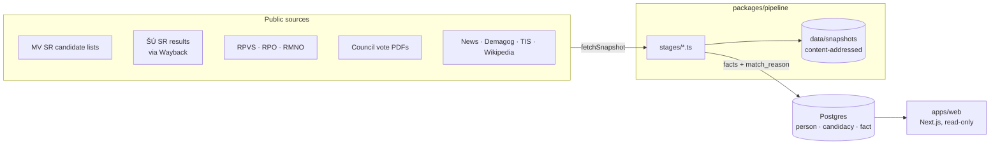

<div align="center">

# Koho volím

**Každý kandidát. Iba fakty.** · _Every candidate. Only facts._

Neutral, source-linked profiles of all 5,458 candidates in the 24 October 2026 Slovak municipal and regional elections in the Nitra region. Every fact links to its public source and to an immutable snapshot of what that source said.

[](https://github.com/Yggdrasill501/candidate_scanner/actions/workflows/ci.yml)
[](LICENSE)
[](CONTRIBUTING.md)
[](https://github.com/Yggdrasill501/candidate_scanner/labels/good%20first%20issue)
<br>
[](.nvmrc)
[](pnpm-workspace.yaml)
[](apps/web)
[](tsconfig.json)
[](docker-compose.yml)
[](apps/web/src/lib/i18n.ts)

[Features](#what-it-does) · [Quick start](#quick-start) · [Architecture](#how-it-works) · [Roadmap](ROADMAP.md) · [Contributing](CONTRIBUTING.md) · [Sources](docs/sources.md)



</div>

## Why

In Slovak local elections a voter can face 40+ names on one ballot, most of them unknown. What is publicly recorded about them is scattered across a dozen registers, PDFs and archived pages that nobody has time to search. Koho volím collects it, links it to the right person, and shows it **the same way for every candidate**: in official ballot order, with no rankings, no scores and no adjectives. Where nothing was found, the page says so.

## What it does

|                                                                           |                                                                                |
| ------------------------------------------------------------------------- | ------------------------------------------------------------------------------ |
|   |         |
| **Race pages** compare every candidate on the same rows, in ballot order. | **Profiles** list every collected fact, each with its source and match reason. |

- **My ballot**: pick your municipality and see the four races you vote in.
- **Election history 2018–2022** from the Statistical Office (via the Wayback Machine), linked by name, municipality and age.
- **Business roles** from RPVS and the RPO register; **NGO roles** from RMNO; **asset declarations** of NSK councillors.
- **Council votes**: 147,687 named roll-call votes of the Nitra city council, grouped by topic.
- **Media mentions**, **Demagog.sk fact-checks**, **Transparency International** campaign monitoring, **Wikipedia**.
- **AI summaries** in Slovak, English and Hungarian, generated only from stored facts, every sentence footnoted.
- **2026 results** per race from the Statistical Office.
- **Match reasons everywhere**: a fact linked by name always says _why_ (name ✔ · municipality ✔ · age ✘ · 3 namesakes). Ambiguous matches are shown on every candidate they could belong to, never silently picked.

### Data in the current build

| Persons | Candidacies | Municipalities |   Facts | Source snapshots | AI summaries |
| ------: | ----------: | -------------: | ------: | ---------------: | -----------: |
|   5,458 |      15,427 |            354 | 139,762 |           22,033 |       16,374 |

## Principles

These are invariants, enforced in code review. The full list is in [`specs/koho-volim/FEATURE_SPEC.md`](specs/koho-volim/FEATURE_SPEC.md#invariants).

1. Every displayed fact has a source link and a stored snapshot. Snapshots are never modified or deleted.
2. Every fact linked by name shows its match reason.
3. Every candidate in a race gets the same rows and sections, in ballot order. Nothing is sortable.
4. Collected data is never hidden. Disputed facts stay visible.
5. No ranking, score, recommendation or evaluative language about anyone.
6. Birth dates and street addresses are used for matching only and never stored on public rows.

## Quick start

Requirements: Node 24 (`nvm use`), pnpm, Docker.

```sh
git clone https://github.com/Yggdrasill501/candidate_scanner.git koho-volim
cd koho-volim
cp .env.example .env
pnpm install
pnpm dev:all              # Postgres up, migrations, http://localhost:3000
```

The site starts empty. Load data with the pipeline (this downloads public files and takes a while):

```sh
pnpm pipeline territory candidates history   # the core: who runs where, and their past
pnpm pipeline                                # every default stage
```

Before opening a PR:

```sh
pnpm check   # typecheck + lint + format
pnpm build
```

## How it works



- **Pipelines are the only writers.** Each stage is idempotent: it replaces its own facts in one transaction and records a `pipeline_run`.
- **Every fetched file is stored by SHA-256** under `data/snapshots` and recorded in `source_snapshot`; each fact points at the snapshot that holds it.
- **The website only reads the database.** No source is contacted while a visitor waits.

### Repository layout

| Path                | What it is                                                         |
| ------------------- | ------------------------------------------------------------------ |
| `apps/web`          | Next.js App Router site (SK/EN/HU), Tailwind CSS 4.                |
| `packages/db`       | Kysely client, migrations, generated `schema.ts`.                  |
| `packages/pipeline` | Collection stages (`pnpm pipeline [stage...]`) and shared helpers. |
| `packages/contract` | Types shared between apps.                                         |
| `specs/`            | Feature specs: the source of truth for behaviour.                  |
| `docs/sources.md`   | Every public source we evaluated, verified and rated.              |
| `designs/`          | Static HTML design prototypes.                                     |

### Pipeline stages

| Stage              | Source                               | Produces                                  |
| ------------------ | ------------------------------------ | ----------------------------------------- |
| `territory`        | ŠÚ SR territory table                | elections, municipalities                 |
| `candidates`       | MV SR 2026 XLSX lists                | persons, races, candidacies               |
| `history`          | ŠÚ SR 2018–2022 results (Wayback)    | `past_candidacy`                          |
| `rpvs`             | RPVS OData                           | `business_role`                           |
| `rpo`              | RPO dump (Slovensko.Digital)         | `business_role`                           |
| `nsk-declarations` | unsk.sk declarations                 | `asset_declaration`                       |
| `rmno`             | RMNO NGO register                    | `ngo_role`                                |
| `nitra-votes`      | Nitra city named-vote PDFs           | `council_vote`, `attendance`              |
| `media`            | News search                          | `media_mention`                           |
| `wikipedia`        | Wikipedia + Wikidata                 | `encyclopedia`                            |
| `demagog`          | Demagog.sk                           | `fact_check`                              |
| `tis`              | Transparency International Slovensko | `campaign_account`, `watchdog_evaluation` |
| `topics`           | headless LLM over agenda items       | topic per agenda item                     |
| `summaries`        | headless LLM over stored facts       | `ai_summary` (sk, en, hu)                 |

Want to add a source? Read [`docs/agent-brief.md`](docs/agent-brief.md), which is the how-to for writing a stage.

## Roadmap

The election was on 24 October 2026; the launch scope is built. What is left, from finishing touches to whole new regions, is in **[ROADMAP.md](ROADMAP.md)**. Highlights:

- [ ] Move 2026 results from request-time fetches into a pipeline stage (invariant 5)
- [ ] YouTube session transcripts ([spec](specs/session-transcripts/FEATURE_SPEC.md))
- [ ] Council votes beyond Nitra city: NSK and the six district towns ([spec](specs/council-votes/FEATURE_SPEC.md))
- [ ] Tests for matching rules and payload parsers
- [ ] Other regions: the core stages read one `REGION_CODE`; Nitra-specific stages need equivalents

## Contributing

Contributions are welcome, from fixing a typo in a Hungarian label to writing a collector for a new register. Start with [CONTRIBUTING.md](CONTRIBUTING.md) and look for [`good first issue`](https://github.com/Yggdrasill501/candidate_scanner/labels/good%20first%20issue).

Found a wrong fact about a candidate? Open a [data correction](https://github.com/Yggdrasill501/candidate_scanner/issues/new?template=data_correction.yml) or write to `opravy@kohovolim.sk`.

## License

Code is released under the [GNU Affero General Public License v3.0](LICENSE): you may use, change and redistribute it, and if you run a modified version as a public website, you must publish your source too. Candidate data comes from public Slovak registers and other sources listed in [`docs/sources.md`](docs/sources.md); it remains subject to each source's terms.

<div align="center"><sub>Built in Nitra. Not affiliated with any party, candidate or public authority.</sub></div>
